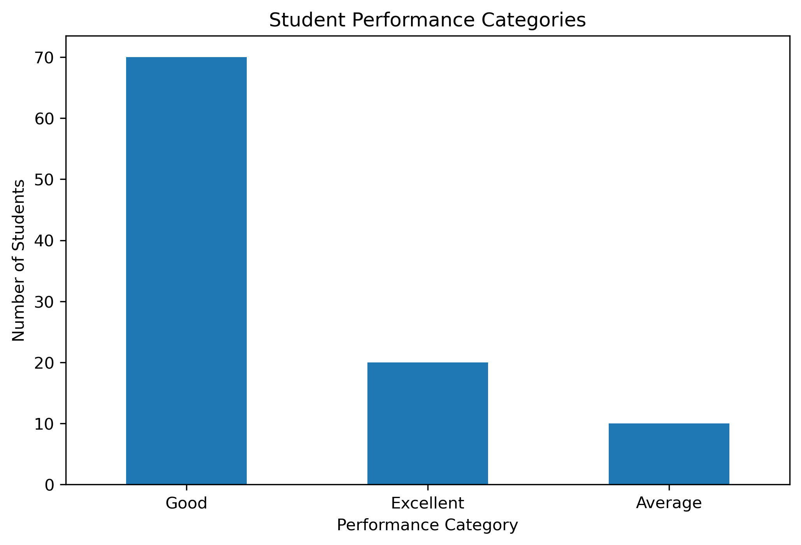
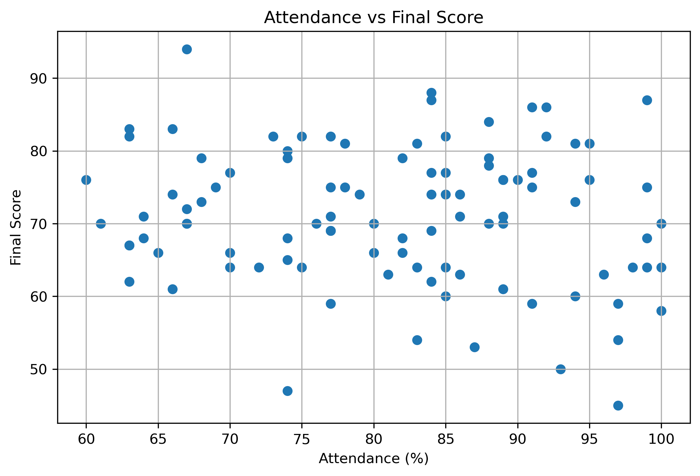
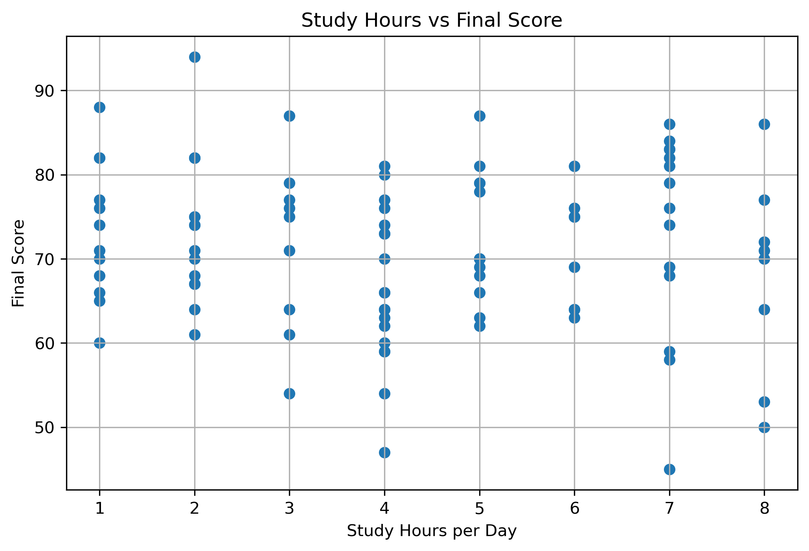
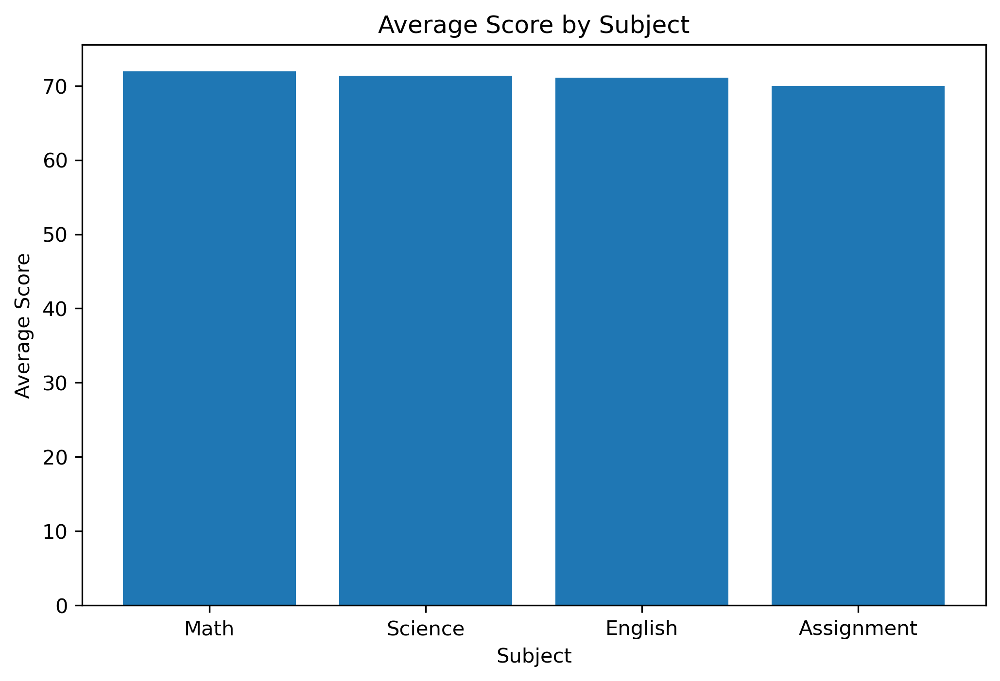
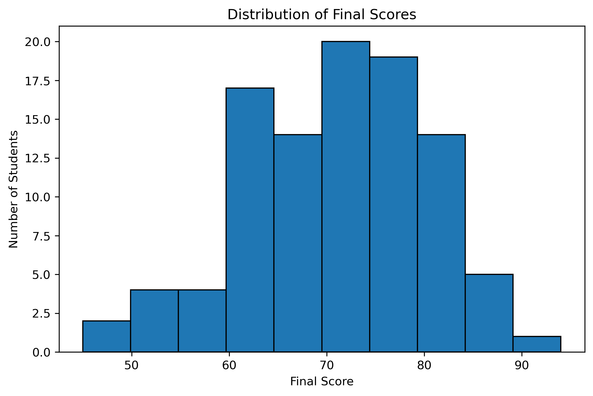
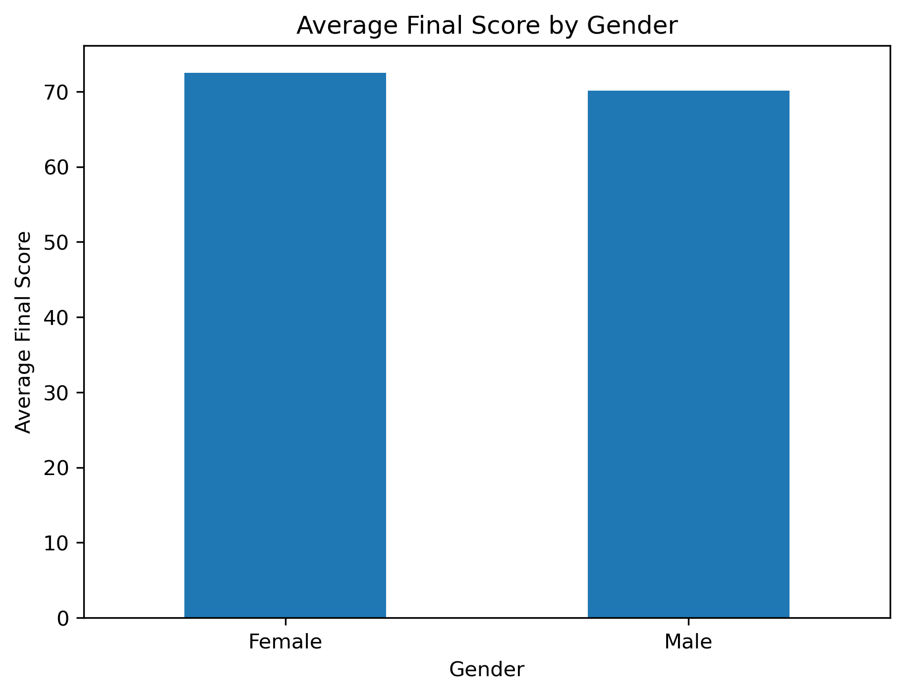
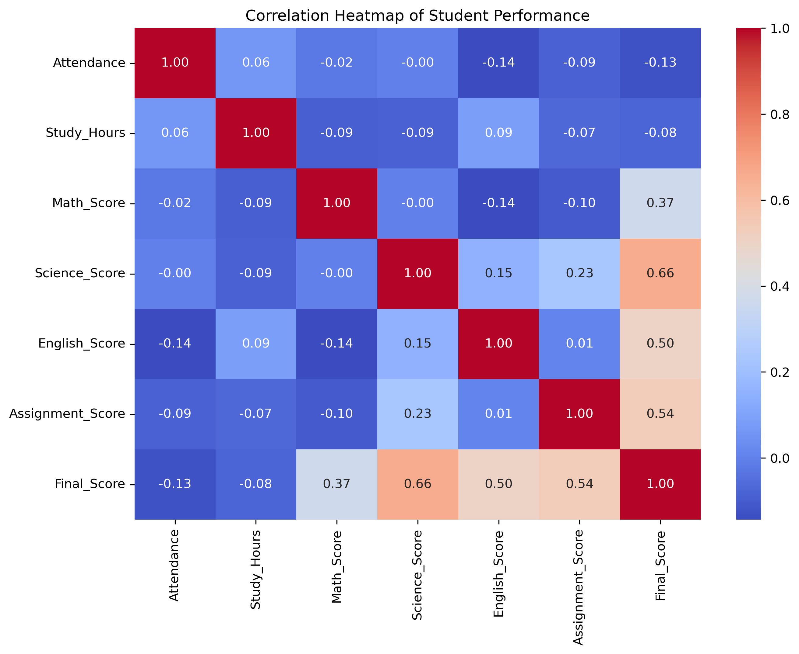
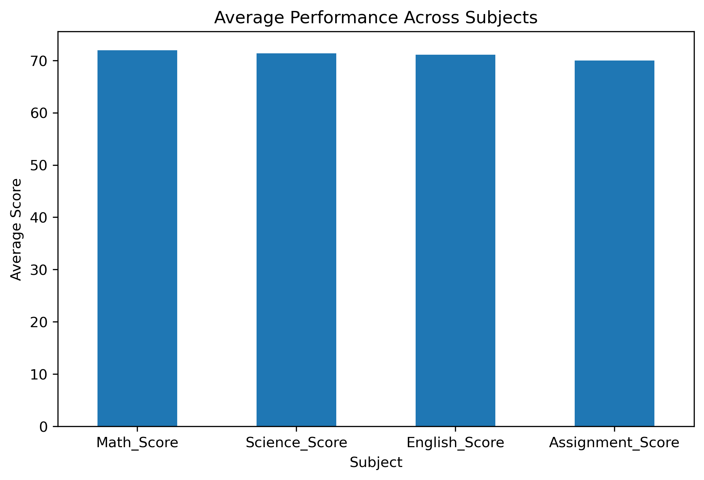
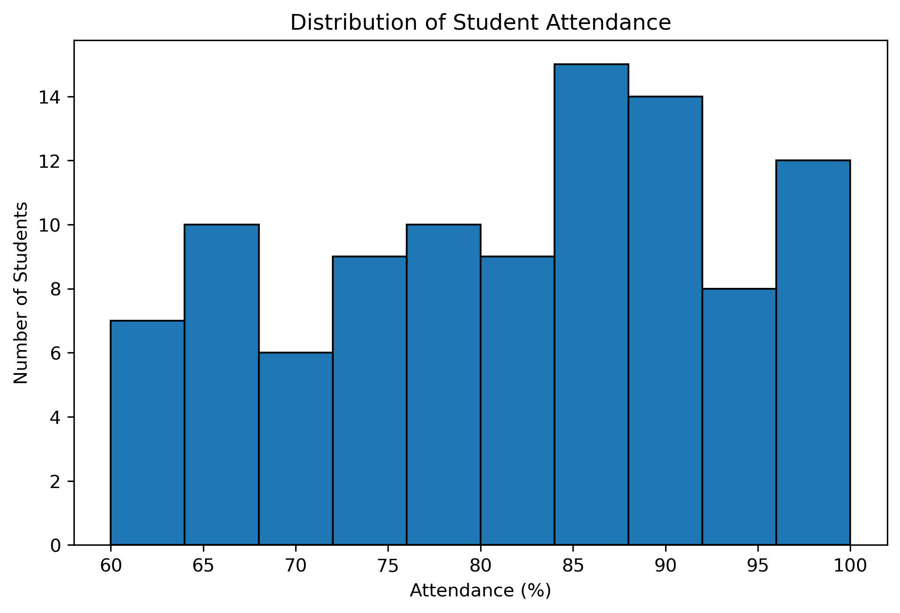
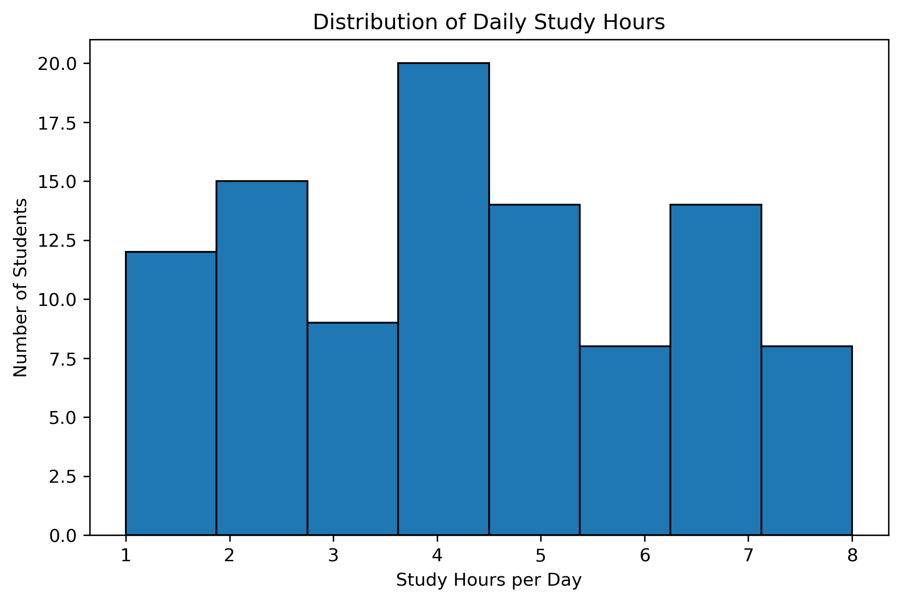

# Student Performance Analysis

## 1. Introduction

Student performance analysis is an important application of data analytics in the education sector. Academic institutions generate large amounts of student-related data such as attendance, study hours, subject scores, assignment scores, and final examination results.

The objective of this project is to analyze student performance data using Python and identify meaningful patterns and relationships. The project uses Pandas for data manipulation and analysis, Matplotlib and Seaborn for visualization, and statistical analysis techniques to understand student performance.

The analysis focuses on academic scores, attendance, study habits, subject-wise performance, gender-wise performance, and relationships between different performance-related variables.

---

## 2. Problem Statement

Educational institutions need effective methods to analyze student performance and identify areas that may require academic attention.

Raw student data can contain useful information, but it is difficult to identify patterns without proper data analysis and visualization.

This project addresses the problem by analyzing student performance data and transforming it into meaningful insights through exploratory data analysis and visualization.

---

## 3. Objectives

The main objectives of this project are:

- To analyze student academic performance.
- To examine attendance and study habits.
- To compare performance across different subjects.
- To analyze the distribution of final scores.
- To examine gender-wise performance.
- To identify relationships between important variables.
- To visualize student performance using charts.
- To identify students who may require additional academic attention.
- To provide data-driven recommendations.

---

## 4. Technologies Used

The following technologies and libraries were used:

| Technology | Purpose |
|---|---|
| Python | Programming and data analysis |
| Pandas | Data manipulation and analysis |
| Matplotlib | Data visualization |
| Seaborn | Statistical visualization |
| Jupyter Notebook | Interactive analysis |
| VS Code | Development environment |
| CSV | Dataset storage |
| GitHub | Project version control |

---

## 5. Dataset Description

The project uses a student performance dataset containing 100 student records.

The dataset contains the following attributes:

| Column | Description |
|---|---|
| Student_ID | Unique student identifier |
| Gender | Student gender |
| Age | Student age |
| Attendance | Attendance percentage |
| Study_Hours | Daily study hours |
| Math_Score | Mathematics score |
| Science_Score | Science score |
| English_Score | English score |
| Assignment_Score | Assignment score |
| Final_Score | Calculated final score |

The Final Score is calculated using the average of Mathematics, Science, English, and Assignment scores.

---

## 6. Methodology

The project follows a structured data analysis process:

1. Dataset creation
2. Data loading
3. Data inspection
4. Data cleaning
5. Exploratory data analysis
6. Performance categorization
7. Statistical analysis
8. Data visualization
9. Correlation analysis
10. Insights and recommendations

---

## 7. Data Cleaning

The dataset was inspected for missing values and duplicate records.

The analysis confirmed that the dataset contains no missing values and no duplicate records.

Data types and dataset dimensions were also examined before performing further analysis.

---

## 8. Exploratory Data Analysis

Exploratory Data Analysis was performed to understand the characteristics and distribution of the student dataset.

The analysis included:

- Dataset dimensions
- Statistical summary
- Average subject scores
- Average attendance
- Average study hours
- Highest and lowest scores
- Performance categories
- Gender-wise performance
- Score distribution
- Correlation analysis

---

## 9. Performance Analysis

Students were categorized according to their Final Score using the following classification:

| Final Score | Category |
|---|---|
| 80 and above | Excellent |
| 60–79 | Good |
| 40–59 | Average |
| Below 40 | Needs Improvement |

This classification provides a simple way to understand the overall distribution of student performance.

---

## 10. Data Visualizations

### 10.1 Performance Categories

The following chart shows the distribution of students across the different performance categories.

---

### 10.2 Attendance vs Final Score

This scatter plot shows the relationship between student attendance and final score.

---

### 10.3 Study Hours vs Final Score

This visualization shows the relationship between daily study hours and final score.

---

### 10.4 Subject Comparison

This chart compares the average scores across Mathematics, Science, English, and Assignment performance.

---

### 10.5 Final Score Distribution

The histogram shows the distribution of final scores among the students.

---

### 10.6 Gender-wise Performance

This chart compares the average final score between male and female students.

---

### 10.7 Correlation Heatmap

The correlation heatmap shows relationships between attendance, study hours, subject scores, assignment scores, and final score.

---

### 10.8 Subject Average Comparison

This visualization compares average performance across the major academic subjects.

---

### 10.9 Attendance Distribution

This histogram shows how attendance percentages are distributed among students.

---

### 10.10 Study Hours Distribution

This histogram shows the distribution of daily study hours among students.

## 11. Key Findings

The analysis provides several important observations:

- Most students fall within the Good performance category.
- A smaller proportion of students fall within the Excellent category.
- Attendance and study hours can be examined in relation to final academic performance.
- Subject-wise analysis helps identify differences in average performance.
- The score distribution provides an overview of how student scores are spread across the dataset.
- Correlation analysis helps identify relationships between academic and behavioral variables.
- Students with lower final scores can be identified for further academic monitoring.

---

## 12. Recommendations

Based on the analysis, the following recommendations can be considered:

1. Regularly monitor student attendance.
2. Encourage consistent and effective study habits.
3. Identify subject-wise areas where students may require additional support.
4. Monitor assignment performance as part of continuous assessment.
5. Use student performance data to provide targeted academic support.
6. Perform performance analysis periodically to identify changes over time.

---

## 13. Conclusion

The Student Performance Analysis project demonstrates how Python-based data analytics can be used to transform raw student data into meaningful information.

Pandas was used for data manipulation and analysis, while Matplotlib and Seaborn were used to create visualizations. The project analyzed academic scores, attendance, study hours, subject-wise performance, gender-wise performance, score distribution, and correlations between important variables.

The analysis provides a structured approach to understanding student performance and demonstrates the practical application of data analytics in the education domain.

---

## 14. Future Scope

The project can be extended in several ways:

- Develop machine learning models to predict student performance.
- Predict students who may require additional academic support.
- Add historical semester-wise data.
- Develop an interactive Power BI dashboard.
- Build a Streamlit web application.
- Include additional student-related factors.
- Automate periodic performance reports.
- Deploy the analysis as an educational analytics application.

---

## 15. References

1. Python Documentation
2. Pandas Documentation
3. Matplotlib Documentation
4. Seaborn Documentation
5. Jupyter Documentation